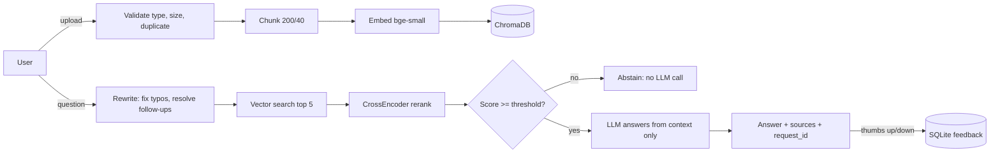

# HR Policy Bot (OpsMind AI)

Upload an HR or IT policy (PDF/TXT) and ask questions in plain English. Answers come **only** from your documents, with sources. If the documents do not contain the answer, the bot says so instead of guessing.

**Live demo:** https://bargavishaila-hr-policy-bot.hf.space  |  **Code:** https://github.com/BargaviS/opsmind-ai

## Architecture



## Features

- Two-stage retrieval (vector search, then CrossEncoder reranking) with a relevance threshold that makes the bot refuse unanswerable questions without calling the LLM.
- Query rewriting, so typos and follow-ups like "what about paternity?" still search correctly.
- Upload safety: file type and size limits, duplicate detection, safe errors for corrupt or empty files.
- Per-IP rate limiting, request IDs on every response, `/health` and `/ready` endpoints, and a feedback endpoint stored in SQLite.
- 31 automated tests that use fake models (no internet, no paid API) and GitHub Actions CI.
- A reproducible evaluation script: 50 labelled questions over 2 documents, writes `evaluation/report.md`.

## Run locally

```bash
python3 -m venv .venv && source .venv/bin/activate
pip install torch==2.4.1 --index-url https://download.pytorch.org/whl/cpu
pip install -r requirements.txt
cp .env.example .env        # put your free GROQ_API_KEY inside
PYTHONPATH=. uvicorn app.main:app --reload
```

Open http://localhost:8000 (chat) and http://localhost:8000/docs (API docs). Or with Docker: `docker compose up --build`.

## Test and evaluate

```bash
pip install -r requirements-test.txt && ENV=test pytest -q && ruff check .
PYTHONPATH=. ENV=test python scripts/evaluate.py            # writes evaluation/report.md
PYTHONPATH=. python scripts/evaluate.py --rewrite           # also measures query rewriting (needs GROQ_API_KEY)
```

## Results

Paste the tables from `evaluation/report.md` here after you run the script. Only use numbers that script printed.

## Deploy to Hugging Face Spaces

1. Create a **Docker** Space. Add `GROQ_API_KEY` under Settings > Variables and secrets (as a Secret).
2. `git remote add space https://huggingface.co/spaces/<user>/<space>` then `git push --force space main`.
3. Wait for the build (5 to 15 minutes). Your link is `https://<user>-<space>.hf.space`.

## API

| Method | Path | Purpose |
|---|---|---|
| GET | `/health` | liveness + number of documents |
| GET | `/ready` | vector store and database reachable |
| POST | `/upload` | PDF/TXT, max 10 MB, duplicate-safe |
| GET | `/search?query=` | retrieval only (debugging) |
| POST | `/chat` | `{query, history}` returns `{answer, sources, abstained, request_id, rewritten_query}` |
| POST | `/feedback` | `{request_id, rating: up/down, reason?}` |

## Key design decisions

| Decision | Why |
|---|---|
| Reranking after vector search | Vector search is fast but approximate; the CrossEncoder reads question and chunk together, which is more precise on a few candidates. |
| Threshold on the reranker score | Prevents weak context reaching the LLM; saves cost on off-topic questions. Tuned with the evaluation script, not guessed. |
| Small chunks (200 chars) | In testing, 500-character chunks mixed many policies together and the reranker scored the right chunk near zero. |
| Local embeddings and reranker | No API cost or rate limits for those steps; the LLM is the only paid or limited call. |
| Model name in an environment variable | Providers retire models (the original one was shut down), so changing it needs no code edit. |
| SQLite for feedback | Zero setup, standard library, enough for this scale. |

## Known limitations

- Free Hugging Face disk is ephemeral: uploads and feedback disappear on restart.
- No login: all users share one document pool.
- In-memory rate limiter (single process only).
- Chunk size and threshold were tuned on a small synthetic benchmark; re-tune on real documents.
- Scanned PDFs, tables and non-English documents are not supported.
- Query rewriting adds one extra LLM call (more latency and cost) per question.

See `SECURITY.md` for the threat model.
